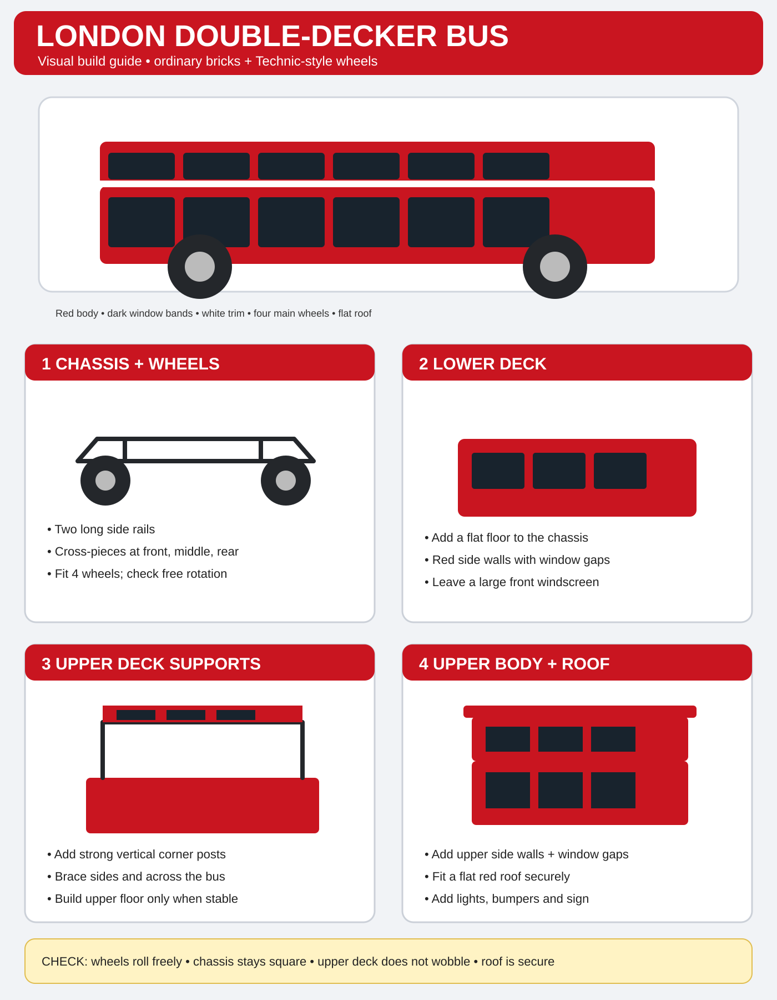

# London-Style Double-Decker Bus — Build Guide

**Version:** 1.0  
**Prepared:** 20 November 2026

A practical build plan for a compact, realistic red London-style double-decker bus using the builder's mixed ordinary bricks/plates and Technic-style wheels.

> **Inventory note:** The available photograph shows mixed red, black, yellow and white pieces. The builder clarified that the wheels are Technic-style: four main wheels plus two smaller wheels. Exact brick counts, axle lengths, hub types and connector compatibility cannot be confirmed from the overview photograph. This guide therefore gives an adaptable construction sequence rather than inventing an exact parts count.

## Visual build guide

[Open the full-size illustrated guide](London-Double-Decker-Bus-Visual-Guide.svg)

## 1. Design brief

- Two passenger decks, with two distinct rows of windows.
- Four main wheels mounted on front and rear axles.
- Red body; black window bands, chassis details and bumpers; white destination board and trim; yellow headlights.
- A flat, securely attached roof.
- Strong lower chassis and a braced upper-deck support frame.

The two smaller wheels are optional decorative parts. Do not force them onto the main axles or use them if they rub against the body.

## 2. Sort the pieces

| Colour / type | Intended use |
|---|---|
| Red ordinary bricks and plates | Main body, side panels, front/rear bodywork and roof |
| Black bricks/plates | Chassis reinforcement, window frames, bumpers and wheel surrounds |
| White pieces | Windscreen surround, destination board and trim |
| Yellow pieces | Headlights and small accents |
| Four main Technic-style wheels | Two front and two rear road wheels |
| Two smaller wheels | Optional decorative details |
| Axles, hubs, beams or pins (if present) | Wheel mounting and structural reinforcement |

Sort the Technic connectors separately. Test-fit each axle/hub combination gently; compatible parts should fit without force.

## 3. Proportions

Use a long, narrow rectangular footprint. As a starting point, aim for a body length about 2.5–3 times its width. Keep the model low and wide enough to resist tipping. The upper deck should not overhang excessively. These are visual guidelines, not fixed measurements; adapt them to the actual pieces.

## 4. Construction

### Stage A — Rolling chassis

1. Find two long, strong beams or make two long side rails from overlapping plates.
2. Join them at the front and rear with cross-pieces to form a rectangle. Add a centre cross-piece if available.
3. Fit the front axle near the front end and the rear axle near the rear end. Leave clearance so the wheels can rotate without touching the body.
4. Attach the four main wheels using compatible hubs/axles. Keep the wheels parallel and aligned.
5. Roll the chassis on a flat surface. Fix rubbing, wobble or misalignment before adding bodywork.

**Checkpoint:** The chassis should roll freely, sit level and remain rectangular. Never bend an axle or force a wheel onto an incompatible hub.

### Stage B — Lower-deck floor

1. Cover the chassis with flat plates or a tightly interlocked layer of ordinary bricks.
2. Keep the floor level.
3. Leave clearance above both axles so the tyres can rotate.
4. Test-fit the floor on the chassis and check that no part touches the tyres.

### Stage C — Lower passenger body

1. Build the front, rear and two side walls from red pieces.
2. Leave a large front windscreen opening and repeated rectangular side-window openings.
3. Use black pieces as window frames or a dark window band. If there are no transparent pieces, leave the windows open or use black pieces as a stylised glazing effect.
4. Add a black front bumper and small yellow headlights.
5. Keep the top edges of both side walls level; they will help support the upper deck.

### Stage D — Upper-deck support frame

1. Add strong vertical supports at the front and rear corners of the lower body.
2. Add one or more supports along each side if pieces permit.
3. Connect the supports with long pieces along both sides and across the front/rear.
4. Gently test the frame for wobble. If it flexes, add cross-bracing or reduce unsupported spans.
5. Do not build the upper deck until this frame is stable.

The upper deck must rest on several supports, not merely balance on two small points.

### Stage E — Upper-deck floor and walls

1. Make a flat upper floor from plates or interlocking bricks. Keep it aligned with the lower body.
2. Attach it to the support frame at multiple points.
3. Build red upper-deck side walls and leave a second row of rectangular window openings.
4. Use black pieces for the window frames. Keep both sides reasonably symmetrical.
5. Add a front upper windscreen opening above the lower windscreen.

### Stage F — Roof

1. Join red plates or bricks to make a flat roof panel.
2. Make it broad enough to cover the upper deck without adding unnecessary height.
3. Attach it at several points so it cannot slide off. A removable roof is useful while adjusting the interior.

### Stage G — Front, rear and side details

- **Front:** white destination-board panel above the upper windscreen; yellow headlights; black bumper.
- **Rear:** small red/yellow lights if available; black lower bumper.
- **Sides:** black window strips, optional white trim and a simple entrance-door outline near the front.
- **Wheels:** keep all four main wheels exposed and free to turn. Use the two smaller wheels only if they fit securely and do not interfere.

## 5. Final inspection checklist

- [ ] Four main wheels touch the ground evenly.
- [ ] Wheels rotate without rubbing the body.
- [ ] Chassis stays rectangular and does not twist.
- [ ] Lower deck is firmly attached to the chassis.
- [ ] Upper deck is supported at multiple points and does not wobble.
- [ ] Left and right window rows are reasonably symmetrical.
- [ ] Roof is secure and not excessively heavy.
- [ ] No loose pieces fall off during gentle handling.

## 6. Troubleshooting

| Problem | Check / adjustment |
|---|---|
| Bus does not roll freely | Check wheel alignment, axle clearance and tyre rubbing. |
| Chassis twists | Add cross-pieces between the long side rails and strengthen the centre. |
| Upper deck wobbles | Add vertical supports and side-to-side cross-bracing; attach the floor at more points. |
| Bus tips easily | Lower the roof, reduce unnecessary height, widen the base if possible and keep heavier parts low. |
| Not enough red pieces | Reserve red for the most visible body panels; use black or white for less visible structural areas. |
| Windows look uneven | Repeat a consistent window spacing pattern; change the number of windows to suit the available pieces. |

## 7. What is needed for an exact parts list

The single overview photo does not show enough detail to count identical pieces or identify axle lengths and connector types. For a precise, numbered revision, take:
1. A clear top-down photo of all ordinary red, black, yellow and white pieces sorted by colour.
2. A close-up of all Technic axles, beams, pins and hubs.
3. A photo of all six wheels beside a ruler.

With those views, the guide can be updated into an exact inventory and numbered subassembly plan.

## 8. Build log

- Date started: ____________________
- Chassis completed: ____________________
- Lower deck completed: ____________________
- Upper deck completed: ____________________
- Final adjustments: ____________________
- Missing pieces / notes: __________________________________________

**Build slowly, test each stage, and adapt the layout to the pieces actually available.**
